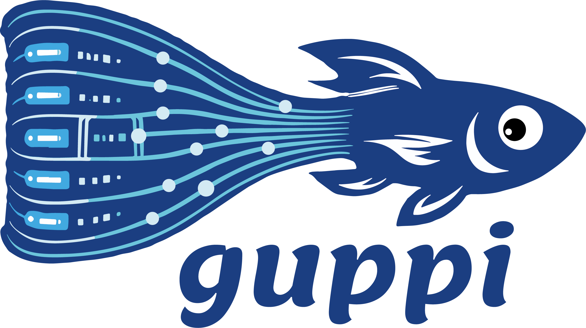
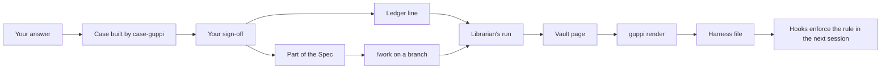
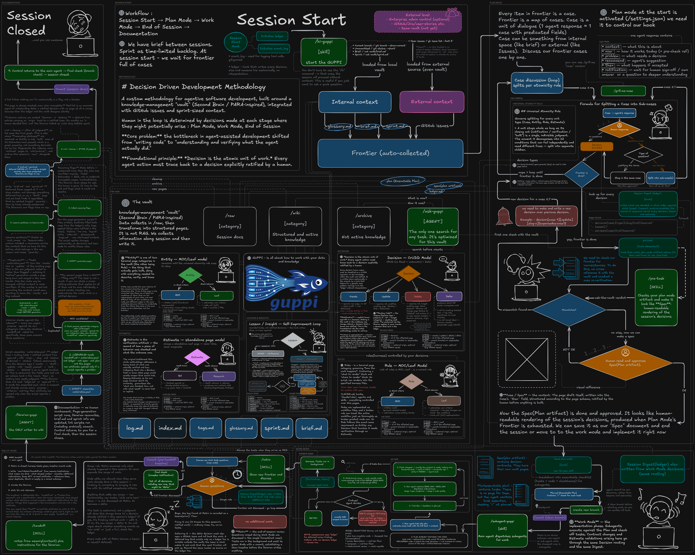

<p align="center"></p>

# GUPPI

A harness for Claude Code in which nothing in the code or its docs changes without a decision you
ratified, and an Obsidian vault in the repository is the project's memory.

GUPPI ships as a Claude Code plugin. It adds hooks, skills, agents and a small Python package to a
project, and runs each working session through a fixed order: plan, ratify, build, review, record.

## Why

I built GUPPI to run my own projects with Claude Code while keeping control over what the agents
change. Every change to the code or its docs goes through a decision I ratify, and each session
leaves a record: the decisions, the checks and what went wrong. In my experience this makes the
project and the agents' work much easier to follow.

The cost is time and tokens. Planning one change takes several rounds of questions and a separate
agent per decision, so a session is slower and more expensive than plain Claude Code.

## Is it for you?

It fits when:

- control over what the agent changes, and a record of why, matter more than speed;
- the project lives long enough that its decisions are worth keeping;
- you are willing to answer questions and sign off each change.

It does not fit when:

- you want a quick prototype or a one-line fix;
- your token budget is tight;
- you want the agent to decide on its own.

## How a session goes

1. **`/hi`** opens the session. It loads the state of the project and lists the open items: the
   Frontier.
2. **Plan Mode.** You pick an item. The agent `case-guppi` builds a Case for it: the context, the
   problem, the choices, and what "done" means. A fork comes to you as a numbered question with a
   recommended answer. You ratify the Case, ask for a change or put it off. One Case per reply.
3. **`/pre-spec`** checks the ratified Cases against each other and against the vault, by the
   agent `ask-guppi`. Its findings go back to the Cases before you approve anything.
4. **The Spec.** The ratified Cases become one plan, which you approve as the Claude Code plan.
5. **`/work`** runs the Spec on a branch other than `main`: a baseline of the tests and checks
   first, then each task in order.
6. **`/retro`** reviews the session: tests, style, the readings of the checks, the lessons. It
   commits on green.
7. **`/handoff`** writes the handoff note, and the agent `librarian-guppi` turns the session's
   decisions into vault pages, renders the harness from them and writes the brief for the next
   session.

Work goes in sprints. `/sprint-open` sets a sprint's goal and its checks of done, and
`/sprint-close` closes it in a session of its own.

## Key terms

| Term | Meaning |
|---|---|
| Case | One decision put to you: its context, the problem, the choices and what "done" means. The agent `case-guppi` builds it; it changes pages of the vault and, through them, the code. |
| Frontier | The list of open items that `/hi` assembles at the start of a session: what needs a decision, what needs none, and what only you can answer. |
| Ratify | Your sign-off on a Case in the chat. Nothing in the code or its docs changes without it. |
| Spec | The Cases ratified in one session, as one plan that you approve and that `/work` runs. |
| Estimate | A check of done: one promise, one way to check it, and its last result, `pending`, `passed` or `failed`. |
| Vault page | One file under `vault/wiki/`, named by its slug: a rule, an entity, an Estimate, a decision, a lesson or an insight. |
| Librarian | The agent `librarian-guppi`, which runs after each session in a clean context and is the only writer of the vault pages. |

## The path of one decision

One answer of yours leaves a trace at each step:

1. **A line in the ledger.** The reply that acknowledges your sign-off carries one line per page
   the Case changes, and a hook writes them into the ledger of the session.
2. **A part of the Spec.** The Case enters the plan that you approve, with its tasks.
3. **The work on a branch.** `/work` runs the tasks on a branch other than `main`, and `/retro`
   commits them.
4. **A vault page.** The librarian turns each ledger line into a new or changed page of
   `vault/wiki/`.
5. **A harness file.** For a rule page, `guppi render` writes the hook, skill or agent file that
   the page governs, and from the next session on the harness enforces the rule.



## What a question looks like

When a Case has a fork, `case-guppi` asks before it builds the Case. A question of a round looks
like this, shortened:

> ❓ **Q1** - **When the reminder goes out**:
>
> **Now:** A booking sends no reminder.
>
> **Options:**
>
> 🔹 **(a) A day before the booking**
>   **After:** Each member gets one reminder 24 hours before the slot.
>
> 🔹 **(b) An hour before the booking**
>   **After:** Each member gets one reminder an hour before the slot.
>
> ➡️ (a). A day leaves the member time to cancel and frees the slot for someone else.

You answer in plain words, for example "a" or "agreed", or with a choice of your own. The agent
then builds the Case and shows it with its ledger lines for your sign-off.

## Main parts

| Part | What it does |
|---|---|
| `vault/` | The memory of the project, readable in Obsidian. `vault/wiki/` holds one folder per kind of page: rules, entities, estimates (the checks), decisions, lessons and insights. `vault/raw/` holds the working folder of each session, and `vault/archive/` what is done. |
| `.claude/` | The harness: hooks in `settings.json`, the skills and the agents `case-guppi`, `ask-guppi` and `librarian-guppi`. These files are rendered from the rule pages of `vault/wiki/rules/` and are not edited by hand; a hook refuses such an edit. |
| `.guppi/` | The Python package with the command `guppi`: the hooks call it, and the librarian runs `guppi check`, `guppi generate`, `guppi render` and others. Its tests stand in `.guppi/tests/`. |
| `plugin/` and the branch `prod` | The plugin `guppi` and its marketplace `guppi-marketplace`. CI builds a clean copy of the project, with no session data and no case references, and writes it to the branch `prod`. |

## The first sketch

GUPPI started from this sketch. It shows only roughly how GUPPI is built: many names and steps
on it have changed since, and the sections above describe GUPPI as it works today.

<p align="center"><a href="plugin/assets/GUPPI.png"></a></p>

The sketch as an Excalidraw board: <https://link.excalidraw.com/l/9tRP8fIyCPi/4Jt5sJbxujf>

## Install

You need [Claude Code](https://code.claude.com), git, and [uv](https://docs.astral.sh/uv/). If
`uv` is missing, `/guppi:install` offers to install it. GUPPI works only in a git repository.

### From GitHub

> No release has reached `prod` yet: CI writes the branch only once no core page of GUPPI
> stands draft. Until then, use the local copy below.

In Claude Code, in the project to install into:

```
/plugin marketplace add kirMykholap/GUPPI#prod
/plugin install guppi@guppi-marketplace
/guppi:install
```

### From a local copy

Clone this repository and build the clean copy into a folder of your choice:

```
git clone https://github.com/kirMykholap/GUPPI.git
cd GUPPI
uv run --project .guppi guppi ship --allow-draft <folder>
```

`--allow-draft` writes the copy even while some core pages are still draft, and lists them. Then,
in Claude Code, in the project to install into:

```
/plugin marketplace add <folder>
/plugin install guppi@guppi-marketplace
/guppi:install
```

### What `/guppi:install` does

It copies the files of GUPPI into the project and builds its Python environment with
`uv sync --project .guppi`. If the project already holds `CLAUDE.md`, files under `.claude/`,
`.gitattributes` or `.github/workflows/checks.yml`, it moves them into `guppi-set-aside/` first,
and the first session shows what each holds so that you keep or drop each part. It writes nothing
into a project that already holds other paths of GUPPI, such as `vault/` or `.guppi/`. If the
session stands in Plan Mode, it first shows one plan with the files it will copy and set aside,
and copies after you approve it.

Then reopen Claude Code in the project and type `/hi`. The first `/hi` runs `/setup`: one setup
Case with the languages of the repository and of the chat, the description of the project and,
where the project has code of its own, how its tests and style check run. After you ratify it,
`/sprint-open` opens the first sprint.

## Use

| Command | When to type it |
|---|---|
| `/hi` | At the start of each working session. |
| `/pre-spec` | When no Case of the Frontier is open; the agent asks before it runs it. |
| `/approve-spec` | When Claude Code offers no approval for the plan. |
| `/work` | To run the approved Spec now, or to resume it. |
| `/carry` | To keep the approved Spec for a later session instead. |
| `/sprint-open` | To open the next sprint, when `/hi` does not start it. |
| `/sprint-close` | In the session that closes the sprint. |
| `/merge-main` | To merge `main` into the branch of the open sprint. |
| `/pr-review <number>` | To review a pull request into `main` as one Case. |
| `/wait-what` | When the last reply did not land, for a plain re-explanation. |

`/retro` and `/handoff` run by themselves at the end of `/work`.

## Status

Early and opinionated. GUPPI is built with itself, one sprint at a time, and its own vault is in
this repository. Expect:

- **cost:** sessions spend many tokens on subagents, and a session is slow;
- **platforms:** it is used mostly on Windows; CI runs the copy's tests on Linux before each
  release;
- **process:** the rules are strict on purpose, and the agent stops to ask more often than plain
  Claude Code;
- **git:** it needs a git repository and works on a branch other than `main`.

## Contributing

Pull requests into `main` are welcome. CI runs the tests, the vault checks and the style check on
each pull request. The owner reviews each one with `/pr-review`, as one Case to ratify whole. The
one rule holds for contributions too: a change to the code or the docs comes with the decision
that ratifies it.

## License

MIT, see [LICENSE](LICENSE).
